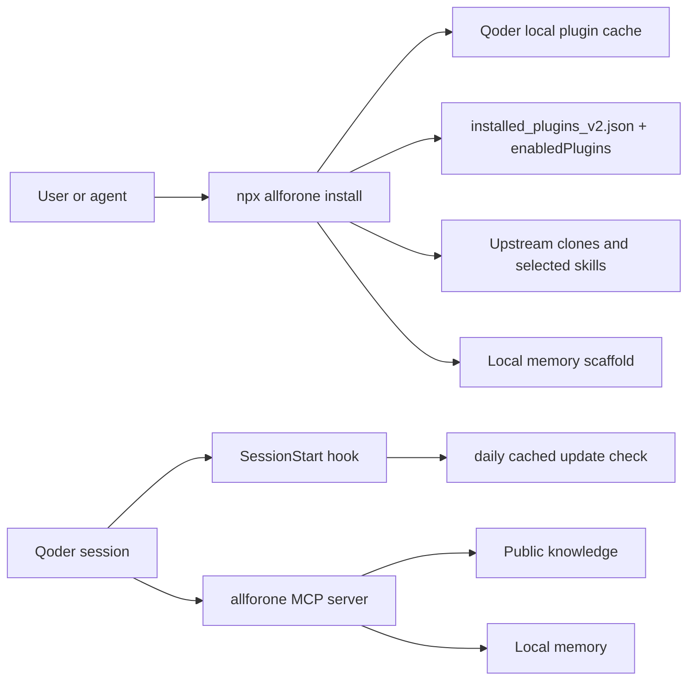

<p align="center">
  
</p>

<h1 align="center">ALL FOR ONE</h1>

<p align="center">
  <b>One install. Every capability.</b><br>
  A self-updating Qoder plugin that gives an agent real skills, public knowledge, deterministic tools,
  a built-in MCP server, local memory scaffolding, and curated upstream packs — not a folder of loose markdown.
</p>

<p align="center">
  <a href="https://github.com/geadalfa/AllForOne"></a>
  
  
  
  
  
  
</p>

<p align="center">
  
</p>

<p align="center">
  <sub>All For One, <i>My Hero Academia</i>. GIF via Tenor. Character and footage belong to their rights holders; the embed is identification only.</sub>
</p>

---

AllForOne is the continuation of the OverhaulMyAgent work. The old name is retired.

## Two commands

Pick one. Do not run both.

### Minimal

Core skills plus the profiles you choose, then only the upstream repositories that match those profiles.

```bash
npx --yes github:geadalfa/AllForOne install --minimal
```

### Full

Every public skill, knowledge document, tool, MCP server, memory scaffold, and upstream pack.

```bash
npx --yes github:geadalfa/AllForOne install --full
```

If you are an LLM agent, stop and ask the user **“Minimal or Full?”** before running anything. The full protocol is in [AGENTS.md](AGENTS.md).

## What this is

- **A Qoder plugin, not a prompt dump.** The repository contains `.qoder-plugin/plugin.json`, real skills, commands, a hook, and a `.mcp.json`. Installing registers and enables the plugin in Qoder.
- **A self-updating bundle.** A daily cached check updates the plugin and every tracked upstream repository. The user can opt out at install time or later.
- **A public edition.** Private memory, employer data, internal endpoints, customer records, credentials, and private repository names are not in this repository. Local memory stays on the machine.

## What you get

| Component | Count | What it does |
|---|---:|---|
| Skills | 61 | Routed workflows for engineering, security, finance, writing, research, UI, documents, automation, and LLM work. |
| Knowledge documents | 30 | Public reference material loaded one to three files at a time, never all at once. |
| Deterministic tools | 14 | Token-efficient reads, web capture, document conversion, finance math, spec tracking, display analysis, and more. |
| MCP server | 1 | `allforone` stdio server with status, knowledge search, skill listing, memory search/add, update check, and policy tools. |
| Memory | Local scaffold | `MEMORY.md`, topic files, and a secret-rejecting `memory_add` tool. Never published. |
| Commands | 5 | `/allforone-install`, `/allforone-status`, `/allforone-update`, `/allforone-knowledge`, `/allforone-memory`. |
| Hooks | SessionStart | Injects a compact bootstrap and starts the daily update check in the background. |
| Upstream packs | 12 | Cloned or installed depending on the selected profiles. |

## Minimal vs Full

| | Minimal | Full |
|---|---|---|
| Core skills | Yes | Yes |
| Chosen profile skills | Yes | All |
| Knowledge documents | Core + matching docs | All 30 |
| Tools | Yes | Yes |
| MCP server | Yes | Yes |
| Local memory scaffold | Yes | Yes |
| Upstream repositories | Matching profiles only | All 12 |
| Install time | Short | Longer; clones every tracked repository |

Profiles: `engineering`, `frontend`, `security`, `finance`, `writing`, `research`, `automation`, `documents`, `creative`, `llm`, `data`.

Non-interactive minimal install:

```bash
npx --yes github:geadalfa/AllForOne install --minimal --profiles engineering,security --yes
```

## How it works



1. The CLI copies the plugin into `~/.qoder/plugins/cache/local/allforone/<version>/`.
2. It merges `allforone@local` into `installed_plugins_v2.json` and enables it in `settings.json`. Existing entries are preserved.
3. It installs the selected upstream packs and records their commits.
4. It creates `~/.allforone/memory/` from empty templates and adds a managed pointer to Qoder memory.
5. On the next Qoder start, the SessionStart hook injects a short bootstrap and starts the daily update check in the background.
6. The built-in MCP server exposes knowledge, skill, status, memory, update, and policy tools to the agent.

## Auto-update

Auto-update is **on by default** for both the plugin and the upstream repositories. The first install asks once; `--no-auto-update` opts out.

- One check per day, with a 24-hour cache per target.
- Self-update pulls the newest AllForOne commit, copies it into a versioned cache path, and re-registers the plugin.
- Upstream update runs `git fetch` and a fast-forward reset only inside AllForOne-managed clones. A clone with local changes is skipped, never discarded.
- The result is written to `~/.allforone/cache/update-status.json`.
- Restart Qoder after an update so the new skills load.

Disable later:

```bash
npx --yes github:geadalfa/AllForOne config autoUpdate.self false
npx --yes github:geadalfa/AllForOne config autoUpdate.upstreams false
```

Force a check:

```bash
npx --yes github:geadalfa/AllForOne update --force
```

## Privacy

This repository is built to be publishable.

- No real memory. The repository ships an empty memory template and a protocol; it never ships the author’s memory.
- No employer data. Internal systems, endpoints, microservice names, squad names, ticket contents, and repository maps are excluded.
- No credentials. The privacy scanner rejects token prefixes, private keys, private IPs, personal home paths, and non-example emails.
- No telemetry. The only network calls are `git` operations against the configured repository URLs.
- The anime GIF is embedded from Tenor; it is not part of the software license.

Run the same gate locally:

```bash
node scripts/privacy-scan.mjs
node scripts/privacy-scan.mjs --history
```

The working-tree scan must report zero findings. The history scan is required before a public release.

## Requirements

- Qoder Desktop.
- Node.js 18 or newer. Node 20+ is recommended. The optional Konoha runtime needs Node 24+.
- Git for upstream tracking and self-update.

## Install details

| Flag | Effect |
|---|---|
| `--minimal` | Core plus selected profiles. |
| `--full` | Everything public plus all upstream packs. |
| `--profiles a,b` | Profile list for minimal mode. |
| `--no-auto-update` | Disable daily self and upstream updates. |
| `--no-upstreams` | Skip third-party repositories entirely. |
| `--offline` | Skip all network operations. |
| `--qoder-dir PATH` | Override the Qoder config directory. |
| `--state-dir PATH` | Override the AllForOne state directory. |
| `--yes` | Skip confirmations. |

Manual Qoder import:

1. Clone this repository.
2. Build a ZIP with `npm run pack`, or point Qoder at the repository folder.
3. In Qoder: **Settings → Plugins → + Create Plugin → Import from local folder** (or import the ZIP).
4. Enable `AllForOne` and restart Qoder.

## After install

1. Restart Qoder.
2. Run `npx --yes github:geadalfa/AllForOne status`, or `/allforone-status`.
3. Confirm the version, plugin path, skill count, and update flags.
4. Try a task that crosses domains, for example: “Review this diff, check the UI against the anti-slop rules, and verify the security-sensitive paths.”
5. The agent should load only the matching skills and at most three knowledge documents.

## Upstream packs

| Repository | License | When it is used |
|---|---|---|
| [anti-slop](https://github.com/miqdadbadjuber/anti-slop) | MIT | Frontend and creative profiles; installed as a Qoder plugin if absent. |
| [konoha](https://github.com/andycungkrinx91/konoha) | Apache-2.0 | Engineering and automation profiles; reference clone, manual MCP setup. |
| [claude-trading-skills](https://github.com/tradermonty/claude-trading-skills) | MIT | Finance and data profiles; keyless subset vendored, upstream tracked. |
| [Claude-BugHunter](https://github.com/elementalsouls/Claude-BugHunter) | MIT / CC BY 4.0 | Security profile; static defensive subset only. |
| [gbrain](https://github.com/garrytan/gbrain) | MIT | Research and LLM profiles; conventions, no runtime. |
| [humanizer-id](https://github.com/apissaj/humanizer-id) | MIT | Writing profile; skill pack installed from source. |
| [ui-ux-pro-max-skill](https://github.com/nextlevelbuilder/ui-ux-pro-max-skill) | MIT | Frontend and creative profiles; reference clone. |
| [reality-check](https://github.com/microsoft/amplifier-smart-tool-reality-check) | MIT | Engineering and research profiles; skill installed from source. |
| [superpowers](https://github.com/obra/superpowers) | MIT | Engineering profile; reference clone, Marketplace runtime recommended. |
| [ha-mcp](https://github.com/homeassistant-ai/ha-mcp) | MIT | Automation profile; reference only, requires Home Assistant. |
| [paper-orchestra](https://github.com/google-research/paper-orchestra) | Apache-2.0 | Research profile; reference only. |
| [RuView](https://github.com/ruvnet/RuView) | MIT | Research profile; reference only, real sensing needs hardware. |

Full notices and license texts are in [THIRD_PARTY_NOTICES.md](THIRD_PARTY_NOTICES.md) and `licenses/`.

## Commands

| Command | Purpose |
|---|---|
| `npx --yes github:geadalfa/AllForOne install --minimal` | Minimal install. |
| `npx --yes github:geadalfa/AllForOne install --full` | Full install. |
| `npx --yes github:geadalfa/AllForOne status` | Installed version, paths, skills, upstreams, update state. |
| `npx --yes github:geadalfa/AllForOne update` | Daily cached update check. |
| `npx --yes github:geadalfa/AllForOne update --force` | Ignore the cache. |
| `npx --yes github:geadalfa/AllForOne profiles` | List profiles and skill counts. |
| `npx --yes github:geadalfa/AllForOne config autoUpdate.self false` | Disable self-update. |
| `npx --yes github:geadalfa/AllForOne uninstall` | Remove the plugin registration. |

## Repository layout

```text
AllForOne/
├── .qoder-plugin/plugin.json     Qoder manifest
├── .mcp.json                     built-in MCP server declaration
├── hooks/hooks.json              SessionStart bootstrap
├── commands/                     five user-invocable commands
├── skills/                       61 skills, one folder per skill
├── knowledge/                    public knowledge and INDEX.md
├── tools/                        deterministic helpers
├── memory/                       empty local-memory templates
├── lib/                          installer, updater, Qoder registration
├── bin/                          CLI and MCP server
├── upstreams/registry.json       third-party repository registry
├── profiles.json                 core, profiles, and knowledge mapping
├── scripts/                      validate, privacy scan, ZIP packager
└── tests/                        installer, updater, MCP, and hook tests
```

## Development

```bash
npm test
npm run validate
npm run privacy
npm run pack
```

`npm run privacy` must report zero findings. The CI workflow runs the same three checks.

## Uninstall

```bash
npx --yes github:geadalfa/AllForOne uninstall
```

Add `--purge --yes` to also remove the local state directory, including portable memory and upstream clones. Restart Qoder afterward.

## Credits

AllForOne is assembled from original work and public upstream projects. See [THIRD_PARTY_NOTICES.md](THIRD_PARTY_NOTICES.md).

The plugin structure follows Qoder’s documented conventions: a manifest, skills, commands, hooks, and MCP declarations. The README format follows the anti-slop and Konoha tradition of showing the artifact, not just describing it.

## License

MIT for AllForOne’s original code and prose. Third-party components keep their licenses.
