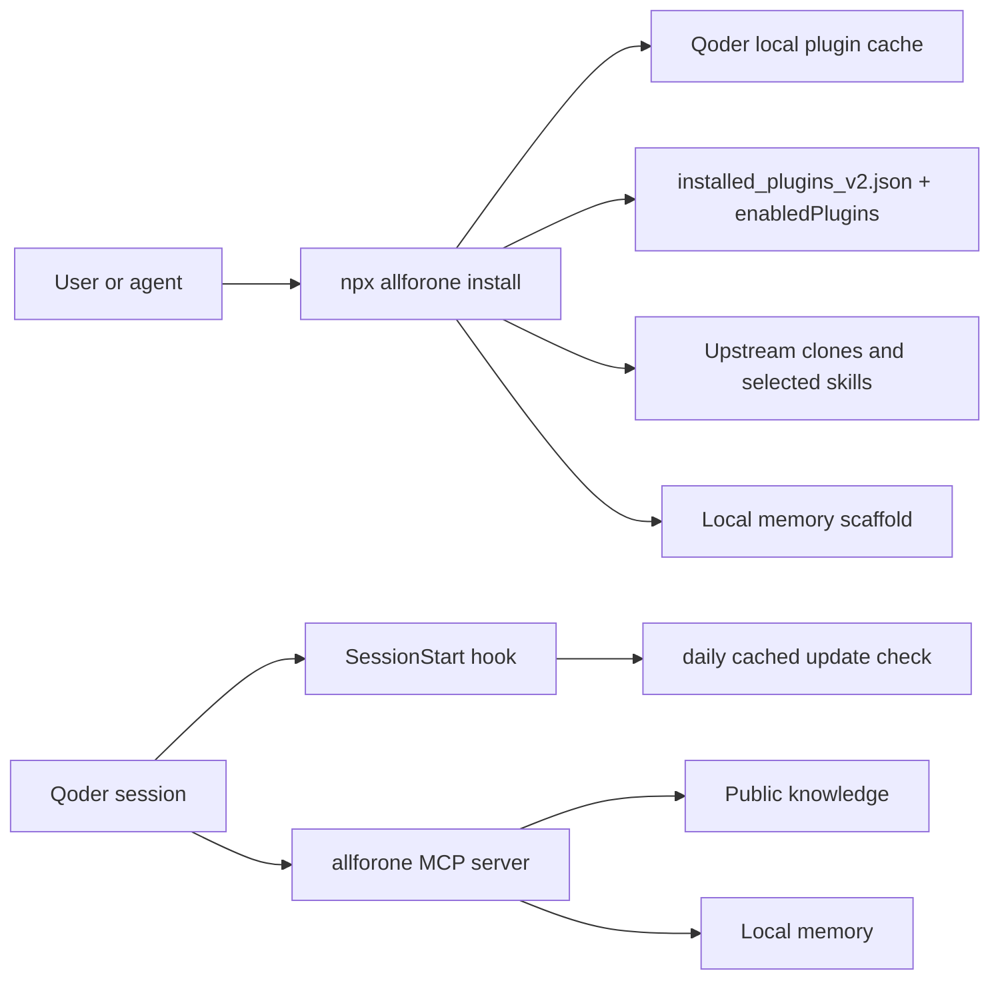

<p align="center">
  
</p>

<h1 align="center">ALL FOR ONE</h1>

<p align="center">
  <b>One install. Every capability.</b><br>
  A self-updating Qoder plugin that gives an agent real skills, public knowledge, deterministic tools,
  a built-in MCP server, local memory scaffolding, and curated upstream packs — not a folder of loose markdown.
</p>

<p align="center">
  <a href="https://github.com/geadalfa/AllForOne"></a>
  
  
  
  
  
  
  
</p>

<p align="center">
  
</p>

<p align="center">
  <sub>All Might vs All For One. Fan media from <i>My Hero Academia</i>; character and footage rights belong to Kohei Horikoshi / Shueisha / Bones. Not covered by the software license.</sub>
</p>

---

AllForOne is the continuation of the OverhaulMyAgent work. The old name is retired.

## Two commands

Pick one. Do not run both.

### Minimal

Core skills plus the profiles you choose, then only the upstream repositories that match those profiles.

```bash
npx --yes github:geadalfa/AllForOne install --minimal
```

### Full

Every public skill, knowledge document, tool, MCP server, memory scaffold, and upstream pack.

```bash
npx --yes github:geadalfa/AllForOne install --full
```

If you are an LLM agent, stop and ask the user **“Minimal or Full?”** before running anything. The full protocol is in [AGENTS.md](AGENTS.md).

## Download the release pack

Prefer a manual install, or want a file you can keep offline? Download the latest ZIP and import it in Qoder.

- [allforone-0.1.1.qoder.zip](https://github.com/geadalfa/AllForOne/releases/download/v0.1.1/allforone-0.1.1.qoder.zip)
- [All releases](https://github.com/geadalfa/AllForOne/releases)

Manual import: **Settings → Plugins → + Create Plugin → Import from local folder or ZIP**, enable AllForOne, then restart Qoder.

## What this is

- **A Qoder plugin, not a prompt dump.** The repository contains `.qoder-plugin/plugin.json`, real skills, commands, a hook, and a `.mcp.json`. Installing registers and enables the plugin in Qoder.
- **A self-updating bundle.** A daily cached check updates the plugin and every tracked upstream repository. The user can opt out at install time or later.
- **A public edition.** Private memory, employer data, internal endpoints, customer records, credentials, and private repository names are not in this repository. Local memory stays on the machine.

## DLSS MFG on RTX 20/30/40

Heavy single-player game and a non-RTX 50 card? The `gaming` profile ships a route picker and safe installers for both community stacks.

- **MFG Unlock 1.10.1** — ReShade add-on. 3x–6x DLSS-G on RTX 40/50, an experimental RTX 20/30 DLSS-G path, XeMFG 2x–6x on RTX 20/30/40/50, and Add frame generation for games without it.
- **DLSS Unlocked NR-v0.9.95** — OptiScaler proxy. Native `dlssg_sm86` MFG on RTX 20/30, RTX 40 unlock up to 6x, Streamline 2.14.16, and DLSS Neural Rendering.

Start with the route picker, not with a file copy:

```bash
python <plugin-root>/tools/mfg_unlock_setup.py route --game "<game-dir>"
```

Single-player only. Never stack both stacks in one game folder. The full guide is [`knowledge/dlss_mfg_unlock_non_rtx50.md`](knowledge/dlss_mfg_unlock_non_rtx50.md).

<details>
<summary>Fight scene (GIF)</summary>

<p align="center">
  
</p>

<p align="center"><sub>GIF via Tenor. Fan media; not covered by the software license.</sub></p>

</details>

## What you get

| Component | Count | What it does |
|---|---:|---|
| Skills | 61 | Routed workflows for engineering, security, finance, writing, research, UI, documents, gaming, automation, and LLM work. |
| Knowledge documents | 31 | Public reference material loaded one to three files at a time, never all at once. |
| Deterministic tools | 14 | Token-efficient reads, web capture, document conversion, finance math, spec tracking, display analysis, DLSS MFG setup, and more. |
| MCP server | 1 | `allforone` stdio server with status, knowledge search, skill listing, memory search/add, update check, and policy tools. |
| Memory | Local scaffold | `MEMORY.md`, topic files, and a secret-rejecting `memory_add` tool. Never published. |
| Commands | 5 | `/allforone-install`, `/allforone-status`, `/allforone-update`, `/allforone-knowledge`, `/allforone-memory`. |
| Hooks | SessionStart | Injects a compact bootstrap and starts the daily update check in the background. |
| Upstream packs | 14 | Cloned or installed depending on the selected profiles. |

## Minimal vs Full

| | Minimal | Full |
|---|---|---|
| Core skills | Yes | Yes |
| Chosen profile skills | Yes | All |
| Knowledge documents | Core + matching docs | All 31 |
| Tools | Yes | Yes |
| MCP server | Yes | Yes |
| Local memory scaffold | Yes | Yes |
| Upstream repositories | Matching profiles only | All 14 |
| Install time | Short | Longer; clones every tracked repository |

Profiles: `engineering`, `frontend`, `security`, `finance`, `writing`, `research`, `automation`, `gaming`, `documents`, `creative`, `llm`, `data`.

Non-interactive minimal install:

```bash
npx --yes github:geadalfa/AllForOne install --minimal --profiles engineering,security --yes
```

## How it works



1. The CLI copies the plugin into `~/.qoder/plugins/cache/local/allforone/<version>/`.
2. It merges `allforone@local` into `installed_plugins_v2.json` and enables it in `settings.json`. Existing entries are preserved.
3. It installs the selected upstream packs and records their commits.
4. It creates `~/.allforone/memory/` from empty templates and adds a managed pointer to Qoder memory.
5. On the next Qoder start, the SessionStart hook injects a short bootstrap and starts the daily update check in the background.
6. The built-in MCP server exposes knowledge, skill, status, memory, update, and policy tools to the agent.

## Auto-update

Auto-update is **on by default** for both the plugin and the upstream repositories. The first install asks once; `--no-auto-update` opts out.

- One check per day, with a 24-hour cache per target.
- Self-update pulls the newest AllForOne commit, copies it into a versioned cache path, and re-registers the plugin.
- Upstream update runs `git fetch` and a fast-forward reset only inside AllForOne-managed clones. A clone with local changes is skipped, never discarded.
- The result is written to `~/.allforone/cache/update-status.json`.
- Restart Qoder after an update so the new skills load.

Disable later:

```bash
npx --yes github:geadalfa/AllForOne config autoUpdate.self false
npx --yes github:geadalfa/AllForOne config autoUpdate.upstreams false
```

Force a check:

```bash
npx --yes github:geadalfa/AllForOne update --force
```

## Privacy

This repository is built to be publishable.

- No real memory. The repository ships an empty memory template and a protocol; it never ships the author’s memory.
- No employer data. Internal systems, endpoints, microservice names, squad names, ticket contents, and repository maps are excluded.
- No credentials. The privacy scanner rejects token prefixes, private keys, private IPs, personal home paths, and non-example emails.
- No telemetry. The only network calls are `git` operations against the configured repository URLs.
- The anime banner, logo, and GIF are fan media. They are not part of the software license.

Run the same gate locally:

```bash
node scripts/privacy-scan.mjs
node scripts/privacy-scan.mjs --history
```

The working-tree scan must report zero findings. The history scan is required before a public release.

## Requirements

- Qoder Desktop.
- Node.js 18 or newer. Node 20+ is recommended. The optional Konoha runtime needs Node 24+.
- Git for upstream tracking and self-update.

## Install details

| Flag | Effect |
|---|---|
| `--minimal` | Core plus selected profiles. |
| `--full` | Everything public plus all upstream packs. |
| `--profiles a,b` | Profile list for minimal mode. |
| `--no-auto-update` | Disable daily self and upstream updates. |
| `--no-upstreams` | Skip third-party repositories entirely. |
| `--offline` | Skip all network operations. |
| `--qoder-dir PATH` | Override the Qoder config directory. |
| `--state-dir PATH` | Override the AllForOne state directory. |
| `--yes` | Skip confirmations. |

Manual Qoder import:

1. Clone this repository.
2. Build a ZIP with `npm run pack`, or point Qoder at the repository folder.
3. In Qoder: **Settings → Plugins → + Create Plugin → Import from local folder** (or import the ZIP).
4. Enable `AllForOne` and restart Qoder.

## After install

1. Restart Qoder.
2. Run `npx --yes github:geadalfa/AllForOne status`, or `/allforone-status`.
3. Confirm the version, plugin path, skill count, and update flags.
4. Try a task that crosses domains, for example: “Review this diff, check the UI against the anti-slop rules, and verify the security-sensitive paths.”
5. The agent should load only the matching skills and at most three knowledge documents.

## Upstream packs

| Repository | License | When it is used |
|---|---|---|
| [anti-slop](https://github.com/miqdadbadjuber/anti-slop) | MIT | Frontend and creative profiles; installed as a Qoder plugin if absent. |
| [konoha](https://github.com/andycungkrinx91/konoha) | Apache-2.0 | Engineering and automation profiles; reference clone, manual MCP setup. |
| [claude-trading-skills](https://github.com/tradermonty/claude-trading-skills) | MIT | Finance and data profiles; keyless subset vendored, upstream tracked. |
| [Claude-BugHunter](https://github.com/elementalsouls/Claude-BugHunter) | MIT / CC BY 4.0 | Security profile; static defensive subset only. |
| [gbrain](https://github.com/garrytan/gbrain) | MIT | Research and LLM profiles; conventions, no runtime. |
| [humanizer-id](https://github.com/apissaj/humanizer-id) | MIT | Writing profile; skill pack installed from source. |
| [ui-ux-pro-max-skill](https://github.com/nextlevelbuilder/ui-ux-pro-max-skill) | MIT | Frontend and creative profiles; reference clone. |
| [reality-check](https://github.com/microsoft/amplifier-smart-tool-reality-check) | MIT | Engineering and research profiles; skill installed from source. |
| [superpowers](https://github.com/obra/superpowers) | MIT | Engineering profile; reference clone, Marketplace runtime recommended. |
| [ha-mcp](https://github.com/homeassistant-ai/ha-mcp) | MIT | Automation profile; reference only, requires Home Assistant. |
| [paper-orchestra](https://github.com/google-research/paper-orchestra) | Apache-2.0 | Research profile; reference only. |
| [RuView](https://github.com/ruvnet/RuView) | MIT | Research profile; reference only, real sensing needs hardware. |
| [MFGAdaUnlock-RenoDx](https://github.com/mavismmg/MFGAdaUnlock-RenoDx) | MIT | Automation and gaming profiles; reference clone, released add-on downloaded by the user. |
| [dlss-unlocked](https://github.com/ShyVortex/dlss-unlocked) | MIT | Automation and gaming profiles; reference clone, setup/standalone release downloaded by the user. |

Full notices and license texts are in [THIRD_PARTY_NOTICES.md](THIRD_PARTY_NOTICES.md) and `licenses/`.

## Full inventory

Every skill, knowledge document, tool, memory surface, and plugin surface in this repository. Each section is collapsed by default; click one to expand it. Upstream packs are listed in the table above and in `upstreams/registry.json`.

<!-- INVENTORY:START -->

<details>
<summary><b>Skills (61)</b> — click to expand</summary>

| Skill | What it does |
|---|---|
| `agent-asset-hygiene` | Use when maintaining the agent's own asset library — knowledge docs and INDEX, skills, memory files, tools, MCP config — especially after ingesting a new source, before bulk edits or deletions, when a skill or knowledge doc looks… |
| `allforone` | Use when the user asks to install, update, inspect, enable, disable, or choose capabilities for AllForOne, the self-updating Qoder capability pack. Also use when an agent must decide between the minimal and full install modes, or… |
| `allforone-knowledge` | Use when a task needs durable guidance from the AllForOne public knowledge base — engineering discipline, UI/UX, security review, finance, writing, research, documents, Windows/macOS engineering, or agent operations. Routes to… |
| `allforone-memory` | Use when the user asks to remember, recall, update, or forget a preference, decision, project fact, or lesson. Keeps portable memory local to the machine, never publishes it, and refuses credentials or customer data. |
| `anti-slop-ui-design` | Design and implement high-taste, anti-AI user interfaces across Desktop, Web, and Mobile. Enforces design contracts (DESIGN.md), neutral color systems (OKLCH/Zinc), typographic hierarchy, platform-native viewports, and… |
| `app-opportunity-lab` | Use when the user wants to brainstorm, validate, design, or build a desktop, web, or mobile app that solves a real problem — especially in finance, psychology/mental health, productivity, pet care, or daily life. Combines problem… |
| `automated-game-modding` | Discover installed games, validate mod compatibility against executable versions, resolve dependency trees, stage archives, and safely deploy/undeploy mods with transactional SHA-256 rollback and live in-game editing support. |
| `backtest-expert` | Expert guidance for systematic backtesting of trading strategies. Use when developing, testing, stress-testing, or validating quantitative trading strategies. Covers "beating ideas to death" methodology, parameter robustness… |
| `bailian-cli` | 阿里云百炼 / Aliyun Bailian / DashScope 资源管理与 `bl` CLI hub： 应用调用（bl app）、决策模型推理（bl decision）、模型目录/模型列表、用量/额度/配额、免费额度、 工作空间、MCP 市场、pipeline、文件上传、ParseX 文档/音视频解析与字段抽取、Batch 批量推理与 CSV 转换、同步 Batch Chat、console API、登录鉴权与配置、 Agent skill… |
| `bailian-docs-llm-wiki` | Use when the user asks about Alibaba Cloud Bailian model catalogs, API parameters, error codes, application development, RAG, memory, plugins, fine-tuning, deployment, or multimodal capabilities. Routes to the official… |
| `bailian-finetune` | 阿里云百炼模型精调训练入口：用户要精调、微调、训练自己的模型（fine-tune，支持 SFT / SFT-LoRA / DPO / DPO-LoRA / CPT， 覆盖文本、语音、图像）、校验或上传训练数据集、看训练进度和日志、挑 checkpoint、导出精调产物、 把专属模型部署成服务时使用 `bl dataset` / `bl finetune` / `bl deploy`。链路是 validate 校验数据 → upload 拿 file-id… |
| `bailian-gen` | 阿里云百炼图片/视频/语音生成与理解入口：用户要生图、画图、生成照片、生成图片、AI 绘画、海报、头像、插画、 文生图（text-to-image）、图生图、改图、修图、多图合成、生成视频、文生视频、图生视频、参考生视频、视频编辑、风格转换、 配音、语音合成（TTS）、朗读、转写、语音识别（ASR），或图片理解、看图问答、视频理解、读视频、多模态理解时使用 `bl image` / `bl video` / `bl speech` / `bl… |
| `bailian-knowledge` | 个人资料接入与知识库使用。当任务需要参考用户自己的历史文档、客户资料、旧方案、会议记录或学习材料时使用， 如“参考以前的资料准备会议”“照旧方案写一版”“之前为什么这样决定”；不要求用户说“知识库”或点名百炼。 用户希望一批资料以后反复使用，或要求接入、更新、查看、暂停、恢复、清理资料库时也使用。 也处理明确的 bl knowledge / kscli 资源操作。纯通用问答、仅总结当前附件、无历史资料需要的写作不触发； 个人偏好与聊天记忆属于… |
| `bailian-managed-agent` | 阿里云百炼托管 Agent 声明式基础设施与 API 命令入口：用户要创建agent、初始化 agents.yaml、校验或预览配置变更、 创建/更新/销毁托管 Agent 或 Deployment、在 Workbench 编辑和调试目录项目、管理本地快照版本，或查询 Agent/Environment/Skill/Vault/Deployment/Memory Store、管理… |
| `bailian-memory` | 个人长期记忆与首次启用引导。当个人背景、偏好或历史会影响答案时使用，包括饮食/出行推荐、 个人计划、按用户习惯写邮件、延续之前的任务；不要求用户说“记得”或点名百炼。 用户提供长期事实、纠正偏好（“以后自然一点”）、确认长期决定（“就选第二种，以后都这样”）， 或要求记住、回忆、查看、忘记、暂停、恢复时也应读取本 Skill；结合前文识别，不能只看最后一句。 先检查本地状态；未配置引导启用，授权后检索和抽取生活/工作记忆。宿主内置记忆不排除此… |
| `bailian-model-recommend` | 阿里云百炼模型选型与推荐。当用户需要"选择、推荐、对比"模型，或描述一个 AI 场景/功能需求（隐含需要帮其决策用哪个模型）时激活。核心意图是帮用户做决策， 不是单纯查资料。触发词：推荐模型、选哪个、哪个适合、对比、做一个XX、实现XX 功能、用什么模型好、XX场景方案。当用户同时涉及模型查询和模型选择时，优先 使用本 skill（本 skill 内部会读取模型数据完成推荐）。 |
| `bailian-protocol` | 阿里云百炼 `bl` 家族共享执行协议（consent 确认、版本预检、鉴权/安装、错误上报、本地文件与输出约定）。 不是面向用户意图的业务入口；当任一 bailian-* 业务 skill（bailian-cli / bailian-gen / bailian-finetune / bailian-managed-agent / bailian-sandbox / bailian-memory / bailian-knowledge /… |
| `bailian-sandbox` | 阿里云百炼 Sandbox 沙箱实例与模版生命周期管理入口：用户要创建、查询、连接、暂停、恢复或释放百炼沙箱， 或查看内置基础镜像、上传模版挂载文件、创建、更新、查询、删除沙箱模版、查看模版构建状态时，使用 `bl sandbox`。 用户要访问已创建实例、打开 WebShell、连接 browser-use 浏览器自动化或 VNC 实时画面时，先获取连接信息，再连接数据面。 不用于宿主执行沙箱设置、E2B 官方云资源或通用文件传输。… |
| `bailian-train-deploy` | 用百炼 CLI (`bl`) 走完"数据→微调训练→导出→部署→调用"的完整闭环，或跳过训练直接部署基座模型。支持文本模型（SFT/DPO/CPT）、音频 TTS 模型（CosyVoice）、图像生成模型（Wan2.7）和视频生成模型（Wan i2v/kf2v）微调。涵盖数据集校验/上传、创建微调任务、等待训练、导出最佳 checkpoint、创建推理部署、等待就绪、给出调用示例。当用户提到在百炼 / DashScope /… |
| `bailian-web-search` | 阿里云百炼联网搜索（web search）入口：为联网搜索 / 网页搜索 / 查最新资讯做路径分发。 `bl search web` 默认走 model 模式（Chat Completions enable_search），任何连接身份 （含 Token Plan）均可用；仅当用户明确要 WebSearch MCP 服务或 pages 列表时用 `--mode mcp`（仅普通 DashScope API Key）；MCP 鉴权失败、未开通或传输失败时… |
| `bughunter-defensive-review` | Use when reviewing code, diffs, or pull requests for security defects, interpreting Checkmarx SCA or SonarQube findings, threat-modeling a flow, triaging a vulnerability report, or writing a security finding for Confluence/CDR.… |
| `corporate-diplomacy-and-career-acceleration` | Transform raw technical updates, bad mood or frustration, escalations, performance reports, and upward communications into tactful, executive-grade corporate language (BLUF, 1-3-1 escalation, blameless post-mortem, XYZ… |
| `data-quality-checker` | Validate data quality in market analysis documents and blog articles before publication. Use when checking for price scale inconsistencies (ETF vs futures), instrument notation errors, date/day-of-week mismatches, allocation… |
| `display-color-calibration` | Audit, calibrate, and optimize computer monitor hardware and color accuracy via DDC/CI VESA MCCS, EDID chromaticity parsing, CIEDE2000 ΔE calculation, gamut clamping (sRGB/DCI-P3), and GPU signal integrity. |
| `document-ocr-and-conversion` | Extract text, tables, and structured data from protected PDFs, scanned images, and watermarked documents without data leakage. Unlocks permissions, bleaches watermarks, preserves layouts, and converts to Word (.docx), Markdown… |
| `drawdown-circuit-breaker` | Evaluate account-level drawdown circuit breaker rules from trader-memory-core state and decide whether new trade risk is allowed today. Uses realized P&L, losing-streak cooldowns, and weekly/monthly drawdown limits without any… |
| `dual-axis-skill-reviewer` | Review skills in any project using a dual-axis method: (1) deterministic code-based checks (structure, scripts, tests, execution safety) and (2) LLM deep review findings. Use when you need reproducible quality scoring for… |
| `edge-strategy-reviewer` | Critically review strategy drafts from edge-strategy-designer for edge plausibility, overfitting risk, sample size adequacy, and execution realism. Use when strategy_drafts/*.yaml exists and needs quality gate before pipeline… |
| `exact-output-protocol` | Use when the user says "JANGAN memanggil tool", "tanpa tool", "tambahkan tepat satu baris", "hapus kalimat", or requests an exact final line or literal output. Enforces zero tool calls and literal output with no acknowledgments… |
| `financial-etf-advisory` | Analyze US ETFs, stocks, and macroeconomic regimes for retail brokerages and global investors with zero hallucination. Enforces real-time MCP data ingestion, deterministic Python computation (pandas-ta, ATR, SMA, RSI)… |
| `flashmind-persistent-memory` | Persistent cross-session agent memory and anti-hallucination guardrail protocol via Engram and Flashmind fallback. Use at task start to recall previous project decisions, bugs, and user context, during development to verify… |
| `futures-position-sizer` | Calculate contract-based futures position sizes from a direction, entry, and stop-loss, using verified per-symbol contract specs (multiplier, tick size, tick value). Use when the user asks how many futures contracts to trade… |
| `github-release-sync` | Use when publishing a GitHub release for a desktop or CLI app. Rebuilds the app, uploads the installer, portable archive, and SHA256SUMS to the matching GitHub release, then verifies every asset URL. |
| `holistic-financial-advisor` | Institutional-grade personal finance, wealth accumulation, cashflow defense, income scaling, and portfolio advisory skill. Enforces the 4-stage Financial Waterfall, zero-raw-math execution via financial_calculator.py, Socratic… |
| `human-technical-writing` | Write human-grade technical documentation, in-app UX microcopy, PR reviews, and developer communication without AI slop. Enforces Google/Apple/Microsoft style guides, bans sycophancy and statistical AI clichés, and applies… |
| `knowledge-ingestion` | Use when the user says "tolong pelajari", "simpan ke knowledge", "pelajari dan simpan", "masukkan ke knowledge", "update pengetahuan", or asks the agent to remember a source. Ingests a repository, URL, document, or concept into… |
| `konoha-agentic-workflow` | Orchestrate multi-agent software engineering workflows using the Konoha Shinobi model (Sannin, Genin, Kage, Jonin, Anbu, Chunin, Tokubetsu-Jonin). Enforces bounded file reads (50-100 lines), token hygiene, Two-Step Zero-AI-Slop… |
| `llm-weight-ablation-and-steering` | Decensor, unalign, steer behavior, or eliminate slop from local transformer LLMs without post-training using Heretic, Arbitrary-Rank Ablation (ARA), Magnitude-Preserving Orthogonal Ablation (MPOA), and Optuna Bayesian… |
| `macos-dmg-builder` | Design, build, verify, and package native macOS applications (.app and .dmg) for Apple Silicon using Swift 6, SwiftUI, XcodeGen, Hardened Runtime, and strict UI/UX Anti-Slop gates. Use when the user asks to create macOS apps… |
| `market-breadth-analyzer` | Quantifies market breadth health using TraderMonty's public CSV data. Generates a 0-100 composite score across 6 components (100 = healthy). No API key required. Use when user asks about market breadth, participation rate… |
| `mfg-unlock-installer` | Use when installing, verifying, or reverting DLSS multi-frame generation unlocks on RTX 20/30/40/50 for heavy single-player games — MFG Unlock (ReShade add-on) or DLSS Unlocked (OptiScaler proxy), including 3x–6x tuning, route… |
| `no-invented-code` | Use whenever writing or suggesting code that calls a function, file, module, package, CLI flag, config key, environment variable, or API endpoint — especially third-party libraries, SDKs, or framework features. Prevents… |
| `noted-workspace-engine` | Structure engineering architectures, project roadmaps, and multi-view database schemas (Table, Board/Kanban, Timeline) using the Noted block-tree connected workspace paradigm, with offline vault persistence and bidirectional… |
| `omp-agent-harness` | Apply the Oh-My-Pi (OMP) terminal agent harness protocol to enforce deterministic hash-anchored edits, in-process LSP/DAP diagnostic verification, git worktree task isolation, dual-model Advisor verification, and anti-amnesia… |
| `plan-first` | Use for any coding task with more than about three steps or touching more than one file — new features, refactors, migrations, multi-file changes, or vague requests like "build X" or "add Y to the app". Read the code, write a… |
| `polyglot-code-intelligence` | Learn, trace, and teach end-to-end polyglot application architectures (Go, PHP, Python, Swift, React Native, Java, Kotlin, Kafka, Redis, SQL) from Bitbucket repositories using Graph-based code intelligence, AST/LSP symbol… |
| `position-sizer` | Calculate risk-based position sizes for long stock trades. Use when user asks about position sizing, how many shares to buy, risk per trade, Kelly criterion, ATR-based sizing, fractional-share sizing, or portfolio risk… |
| `pre-trade-discipline-gate` | Evaluate a local pre-trade checklist before manual order entry, blocking planless, oversized, revenge-risk, market-regime-blocked, or circuit-breaker-blocked entries while journaling the decision for trader-memory-core review. |
| `privacy-publish-gate` | Use before publishing, syncing, or pushing any private agent asset (skills, knowledge, tools, MCP config, plugin payload, memory) to a PUBLIC repository, and whenever asked to "make sure my personal data does not leak". Runs the… |
| `repo-architecture-mentor` | Use when the user asks to learn, trace, teach, or safely refactor a codebase from Bitbucket/GitHub — onboarding to unfamiliar repositories, explaining request/data flows, mapping architecture, understanding the tech stack (Go… |
| `reverse-engineer-anything` | Reverse engineer native, managed, Electron/JavaScript, packaged, firmware, and browser targets with REA. Use shipped-artifact or requested runtime evidence to explain features, compare versions, decompile code, or guide a… |
| `software-qa-and-ui-testing` | Software testing standards, UI state synchronization verification, and multi-item test automation to deterministically detect functional and visual bugs using Playwright, CDP, and the SFDPOT heuristic. |
| `spec-driven-development` | Apply Spec-Driven Development (OpenSpec) workflow to design, propose, implement, and archive features with strict interface contracts, bounded blast radius, and 1:1 unit test parity before writing code. |
| `systematic-debugging` | Use when something is broken — an error message, stack trace, failing test, crash, wrong output, "it doesn't work", build failure, or unexpected behavior. Finds the root cause with evidence before changing code, then records the… |
| `token-efficient-reconnaissance` | Slash LLM token consumption by 60%-98% during codebase exploration, test execution, and debugging using RTK output compression and Graphify AST knowledge graph queries without losing reasoning precision. |
| `trader-memory-core` | Track investment theses across their lifecycle — from screening idea to closed position with postmortem. Register theses from screener outputs, manage state transitions, attach position sizing, review due dates, and generate… |
| `uptrend-analyzer` | Analyzes market breadth using Monty's Uptrend Ratio Dashboard data to diagnose the current market environment. Generates a 0-100 composite score from 5 components (breadth, sector participation, rotation, momentum, historical… |
| `verify-before-done` | Use before claiming any coding task is finished, fixed, working, or passing — after editing code, changing config, adding dependencies, or fixing a bug. Forces running builds/tests/linters and reading the real output instead of… |
| `weekly-performance-digest` | Generate a weekly performance summary from closed trader-memory-core theses — win rate, expectancy, profit factor, R-multiple, MAE/MFE, and win/loss pattern analysis by source skill, exit reason, thesis type, sector, and… |
| `windows-gaming-optimizer` | Optimize heavy Windows games (RDR2, Space Marine 2, Warhammer 3, Witcher 3, etc.) for high visual fidelity without PC thermal exhaustion, enforcing the user's zero-nausea anti-motion-sickness ergonomics (FOV 90-105°, Motion Blur… |
| `zero-regression-refactoring` | Safely execute architectural and code refactoring across polyglot codebases (Go, PHP, Python, Swift, React Native, Java, Kotlin) using the 4 Quality Gates: Call-Graph Blast Radius Mapping, Characterization/Golden Master Testing… |

</details>

<details>
<summary><b>Knowledge documents (31)</b> — click to expand</summary>

| Document | What it covers |
|---|---|
| `agents_md_open_standard_specification.md` | You are writing or auditing AGENTS.md instructions. |
| `anti_vibe_coding_engineering_protocol.md` | You need deterministic engineering rules, blast-radius analysis, and evidence labels. |
| `app_opportunity_lab_playbook.md` | You are validating or designing a new application. |
| `claude_trading_skills_toolkit.md` | You are reviewing the provenance and limits of the trading skill pack. |
| `corporate_communication_and_career_diplomacy.md` | You are writing an escalation, performance update, or executive summary. |
| `cross_platform_uiux_qa_security_playbook.md` | You need the cross-platform QA and security checklist. |
| `disciplined_software_engineering_framework.md` | You need the design, debug, and delivery discipline for a non-trivial change. |
| `dlss_mfg_unlock_non_rtx50.md` | You need DLSS multi-frame generation on RTX 20/30/40, are installing or reverting MFG Unlock or DLSS Unlocked, or must verify frame-generation telemetry. |
| `finance_economics_macro_micro_map.md` | You need the macro and micro finance map. |
| `financial_market_and_etf_intelligence.md` | You are analyzing ETFs, stocks, or market regimes. |
| `gbrain_agent_brain_patterns.md` | You are maintaining agent memory, knowledge, or asset hygiene. |
| `ha_mcp_home_assistant_automation.md` | You are evaluating or using a Home Assistant MCP server. |
| `high_precision_ocr_and_document_conversion.md` | You are extracting text, tables, or structure from PDFs and scans. |
| `holistic_financial_agent_intelligence.md` | You need the full personal-finance advisory framework. |
| `human_writing_and_technical_prose.md` | You are writing documentation, UX copy, or a review. |
| `humanizer_id_indonesian_academic_editing.md` | You are editing formal Indonesian prose. |
| `knowledge_ingestion_automation.md` | You are ingesting a new source into skills, knowledge, or memory. |
| `macos_native_dmg_app_development.md` | You are building a macOS app or a signed DMG. |
| `microsoft_reality_check_smart_tool_analysis.md` | You need to verify that a proposed tool exists and works before recommending it. |
| `pagesource_web_resource_capture.md` | You need to capture a web page's real HTML, CSS, JS, images, or fonts. |
| `paper_orchestra_research_writing_pipeline.md` | You are designing a multi-agent research or writing pipeline. |
| `polyglot_architecture_and_graph_code_intelligence.md` | You are navigating a cross-language codebase or building an impact graph. |
| `psychology_mental_health_and_modern_problems.md` | You need careful, non-diagnostic mental-health context. |
| `reading_habit_psychology.md` | You need the evidence summary on reading habits. |
| `ruview_wifi_csi_sensing.md` | You are working with WiFi CSI sensing or its simulation. |
| `software_qa_and_testing_discipline.md` | You need a test plan, regression gates, or UI state verification. |
| `spec_driven_development_and_token_compression.md` | The work is spec-first, cross-file, or token-heavy. |
| `ui_ux_anti_slop_design_engineering.md` | You are designing or reviewing a user interface. |
| `ui_ux_pro_max_skill_analysis.md` | You need the catalog of palettes, type pairings, and stack guidance. |
| `web_content_extraction_protocol.md` | You need to turn a URL into reliable readable content. |
| `windows_desktop_app_engineering.md` | You are building or packaging a Windows desktop app. |

</details>

<details>
<summary><b>Deterministic tools (14)</b> — click to expand</summary>

| Tool | Purpose |
|---|---|
| `rtk.py` | Compact command output, file signatures, and AST-friendly reads to cut token use. |
| `fetch_web.py` | Fetch a page and return dense Markdown; handles static and JavaScript-heavy pages. |
| `pagesource_capture.py` | Capture a page's real HTML, CSS, JS, images, and fonts with Playwright. |
| `compress_prompt.py` | Compress long prompts or documents with LLMLingua-style settings. |
| `openspec_tool.py` | Initialize, validate, and archive spec-driven changes. |
| `doc_converter.py` | Local document extraction and conversion with no upload. |
| `financial_calculator.py` | Deterministic finance math: loans, compounding, Monte Carlo, portfolio metrics. |
| `financial_mcp_server.py` | Stdio MCP wrapper around `financial_calculator.py`. |
| `monitor_color_tool.py` | EDID, DDC/CI, and CIEDE2000 display analysis. |
| `nvapp_mcp.py` | Bridge to a local NVIDIA App MCP endpoint. |
| `game_mod_tool.py` | Discover games, stage mods, verify versions, and roll back with a manifest. |
| `mfg_unlock_setup.py` | Detect the GPU, choose an MFG route, inspect/install/verify/revert MFG Unlock or DLSS Unlocked, and back up proxy stacks. |
| `corporate_firewall.py` | Rewrite blunt or risky messages into executive-safe language. |
| `macos-ocr.swift` | Native Vision OCR helper. |

</details>

<details>
<summary><b>Memory surfaces (local only)</b> — click to expand</summary>

| File | Purpose |
|---|---|
| `memory/MEMORY.template.md` | Becomes `MEMORY.md` on install; index for the local portable memory. |
| `memory/topics/user.md` | Durable user role, goals, preferences, and responsibilities. |
| `memory/topics/feedback.md` | Corrections and confirmed non-obvious approaches, with the reason. |
| `memory/topics/project.md` | Project decisions, owners, deadlines, and constraints. |
| `memory/notes.md` | Created on the first `allforone_memory_add` call; never published. |

</details>

<details>
<summary><b>Plugin surfaces</b> — click to expand</summary>

| Surface | What it is |
|---|---|
| `.qoder-plugin/plugin.json` | Qoder plugin manifest: skills path, MCP server, hooks, version, and license. |
| `.mcp.json + bin/mcp-server.mjs` | Built-in stdio MCP server: status, knowledge search/read, skill list, memory search/add, update check, and policy. |
| `commands/ (5)` | User commands: install, status, update, knowledge, and memory. |
| `hooks/hooks.json` | SessionStart bootstrap plus the daily cached update check. |
| `profiles.json` | Core set plus 12 profiles: engineering, frontend, security, finance, writing, research, automation, gaming, documents, creative, llm, data. |
| `upstreams/registry.json` | Registry of 14 tracked third-party repositories and their install mode. |
| `lib/ + bin/` | Installer, updater, Qoder registration, state, memory, and CLI entry point. |
| `scripts/` | Validate the manifest and assets, run the privacy scan, and build the release ZIP. |
| `tests/` | Installer, updater, manifest, MCP, hook, and release-pack tests. |
| `assets/` | Logo, banner, and the fan-media notice. |

</details>

<!-- INVENTORY:END -->

## Commands

| Command | Purpose |
|---|---|
| `npx --yes github:geadalfa/AllForOne install --minimal` | Minimal install. |
| `npx --yes github:geadalfa/AllForOne install --full` | Full install. |
| `npx --yes github:geadalfa/AllForOne status` | Installed version, paths, skills, upstreams, update state. |
| `npx --yes github:geadalfa/AllForOne update` | Daily cached update check. |
| `npx --yes github:geadalfa/AllForOne update --force` | Ignore the cache. |
| `npx --yes github:geadalfa/AllForOne profiles` | List profiles and skill counts. |
| `npx --yes github:geadalfa/AllForOne config autoUpdate.self false` | Disable self-update. |
| `npx --yes github:geadalfa/AllForOne uninstall` | Remove the plugin registration. |

## Repository layout

```text
AllForOne/
├── .qoder-plugin/plugin.json     Qoder manifest
├── .mcp.json                     built-in MCP server declaration
├── hooks/hooks.json              SessionStart bootstrap
├── commands/                     five user-invocable commands
├── skills/                       61 skills, one folder per skill
├── knowledge/                    31 public knowledge documents and INDEX.md
├── tools/                        14 deterministic helpers
├── memory/                       empty local-memory templates
├── lib/                          installer, updater, Qoder registration
├── bin/                          CLI and MCP server
├── upstreams/registry.json       14 tracked third-party repositories
├── profiles.json                 core, profiles, and knowledge mapping
├── scripts/                      validate, privacy scan, ZIP packager
└── tests/                        installer, updater, MCP, and hook tests
```

## Development

```bash
npm test
npm run validate
npm run privacy
npm run pack
```

`npm run privacy` must report zero findings. The CI workflow runs the same three checks.

## Uninstall

```bash
npx --yes github:geadalfa/AllForOne uninstall
```

Add `--purge --yes` to also remove the local state directory, including portable memory and upstream clones. Restart Qoder afterward.

## Credits

AllForOne is assembled from original work and public upstream projects. See [THIRD_PARTY_NOTICES.md](THIRD_PARTY_NOTICES.md).

The plugin structure follows Qoder’s documented conventions: a manifest, skills, commands, hooks, and MCP declarations. The README format follows the anti-slop and Konoha tradition of showing the artifact, not just describing it.

## Support

AllForOne is source-available and noncommercial. Donations are welcome and do not grant a commercial license. The maintainer has not published a payment link in this repository yet; open an issue if you want to support the project.

## License

AllForOne's original code and prose are source-available under the **PolyForm Noncommercial License 1.0.0**. You may use, modify, and share them for noncommercial purposes. Commercial use, resale, or paid distribution is not permitted.

This is not an OSI open-source license, because it restricts commercial use. Third-party components keep their own licenses; see [THIRD_PARTY_NOTICES.md](THIRD_PARTY_NOTICES.md) and `licenses/`.

The My Hero Academia artwork in the README is fan media. It is not covered by the software license.
