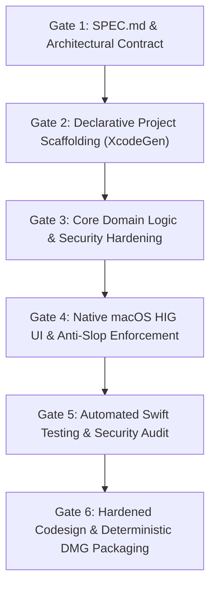

# macOS Native .dmg Application Engineering & Spec-Driven Distribution Standard

Sources: [Apple Developer Documentation](https://developer.apple.com/documentation/) · [Human Interface Guidelines](https://developer.apple.com/design/human-interface-guidelines/) · Swift 6
Author / Owner: the user (the agent Knowledge Base) · License: Internal / Personal Engineering · Version: 1.0.0 · Verified Date: 2026-11-15

---

## 1. What It Is & Why It Matters

Building native macOS applications distributed outside the Mac App Store via disk images (`.dmg`) requires a strict, deterministic, and declarative pipeline. 

### Core Problems Eliminated
1. **Platform Leakage (iOS to macOS Hallucination):** Fast LLMs frequently hallucinate iOS UIKit APIs (`import UIKit`, `UIScreen.main`, `UIColor`, `UIImpactFeedbackGenerator`, `.navigationBarTitleDisplayMode(.inline)`) when targeting macOS.
2. **Project File Corruption (`.pbxproj` XML):** Manually editing or generating Xcode PBX project files leads to syntax corruption and unresolvable merge conflicts.
3. **Statistical UI Slop:** LLMs tend to generate web-style SaaS interfaces (purple/indigo gradient backgrounds, 3-column hovering card grids, hardcoded hex colors, unbounded spring animations, and non-semantic div-soup buttons).
4. **Security Vulnerabilities:** Plaintext secret storage in `UserDefaults`, unhardened executables failing Apple Gatekeeper, and raw command injection via `Process` string interpolation.
5. **Brittle Disk Image Creation:** Ad-hoc Finder scripts or raw uncompressed `.dmg` files instead of structured, compressed `UDZO` images with drag-to-Applications symlinks.

---

## 2. Declarative Toolchain & MCP Ecosystem

| Tool / Technology | Command / Package | Role in Autonomous Agent Pipeline |
| :--- | :--- | :--- |
| **XcodeGen** | `brew install xcodegen` | Primary project generator. Declarative `project.yml` eliminates manual `.pbxproj` edits. |
| **Tuist** | `brew install tuist` | Alternative declarative project specification (`Project.swift`). |
| **xcbeautify** | `brew install xcbeautify` | Strips verbose `xcodebuild` output, saving 80–90% context tokens for LLM error analysis. |
| **SwiftLint & SwiftFormat** | `brew install swiftlint swiftformat` | Enforces Swift 6 strict concurrency, formatting, and static safety rules. |
| **create-dmg** | `brew install create-dmg` | Builds professional `.dmg` installers with custom layout, icon placement, and Applications folder symlink. |
| **hdiutil** | `/usr/bin/hdiutil` | Native macOS fallback disk image utility; creates read-only zlib-compressed `UDZO` images. |
| **codesign & spctl** | Built-in macOS CLI | Signs binaries with Hardened Runtime and audits Gatekeeper acceptance. |
| **notarytool & stapler** | `xcrun notarytool`, `xcrun stapler` | Submits `.dmg` to Apple Notarization Service and attaches the Gatekeeper ticket. |

### Dedicated MCP Servers for Agent Autonomy

```json
{
  "mcpServers": {
    "apple-docs": {
      "command": "$HOME/.nvm/versions/node/v20.19.3/bin/npx",
      "args": ["-y", "@mehmetbaykar/swift-developer-docs-mcp"],
      "env": {
        "PATH": "$HOME/.nvm/versions/node/v20.19.3/bin:/opt/homebrew/bin:/usr/local/bin:/usr/bin:/bin"
      }
    },
    "apple-dev-docs": {
      "command": "$HOME/.nvm/versions/node/v20.19.3/bin/npx",
      "args": ["-y", "@kimsungwhee/apple-docs-mcp"],
      "env": {
        "PATH": "$HOME/.nvm/versions/node/v20.19.3/bin:/opt/homebrew/bin:/usr/local/bin:/usr/bin:/bin"
      }
    },
    "xcodebuild-mcp": {
      "command": "$HOME/.nvm/versions/node/v20.19.3/bin/npx",
      "args": ["-y", "xcodebuildmcp@latest"],
      "env": {
        "PATH": "$HOME/.nvm/versions/node/v20.19.3/bin:/opt/homebrew/bin:/usr/local/bin:/usr/bin:/bin"
      }
    }
  }
}
```

---

## 3. Core macOS Frameworks & Architectural Invariants

### SwiftUI Desktop Topology (macOS 14.0+)
- **Scene Management:**
  - `WindowGroup(id: "main")`: Primary application interface.
  - `Settings`: Native preferences window automatically bound to `Cmd + ,`.
  - `MenuBarExtra`: Menu bar status item app (`.menuBarExtraStyle(.window)` or `.menu`).
- **Desktop Navigation:**
  - `NavigationSplitView(sidebar:detail:)` or 3-column `NavigationSplitView(sidebar:content:detail:)`.
  - `.commands`: Custom macOS menu bar menu items (File, Edit, View, Window).
  - `.searchable`: Integrated desktop search field in toolbar.

### AppKit Interoperability
- `NSApplicationDelegateAdaptor`: Application lifecycle hooks when pure SwiftUI is insufficient.
- `NSWindow`: Window translucency, title bar customization (`.titlebarAppearsTransparent`), and full-size content views.
- `NSVisualEffectView`: Native system materials (vibrancy, active window blending).
- `NSOpenPanel` & `NSSavePanel`: User-driven file access adhering to App Sandbox boundaries.

### Security, Auth & System Integration
- **Keychain Services (`Security` framework):** Store all API tokens, secrets, and credentials via `SecItemAdd`, `SecItemCopyMatching`, `SecItemUpdate`, and `SecItemDelete` with `kSecAttrAccessibleWhenUnlocked`. Zero plaintext storage.
- **LocalAuthentication (`LAContext`):** Biometric Touch ID authentication for sensitive actions.
- **ServiceManagement (`SMAppService`):** Modern macOS 13+ background execution and Launch-at-Login management.
- **Sparkle Framework (`sparkle-project.org`):** Industry standard auto-update framework for direct DMG distributions.

---

## 4. The 6-Gate Deterministic Spec-Driven Pipeline



### Gate 1: Architecture & Specification (`docs/SPEC.md`)
Before writing any Swift code, produce `docs/SPEC.md`:
1. Problem statement & target user workflow (max 5 bullet points).
2. Window topology & navigation structure (`WindowGroup`, `Settings`, `NavigationSplitView`).
3. State management contract: `@Observable` macro (Observation framework) with `@MainActor` isolation and Sendable DTOs.
4. Security & Entitlements Matrix (Least Privilege principle).
5. UI/UX Anti-Slop thesis (semantic system colors, SF typography, keyboard shortcuts).

### Gate 2: Declarative Scaffolding (`project.yml` & Entitlements)
1. Directory structure:
   ```text
   Sources/
     App/
     Models/
     Services/
     Views/
   Resources/
     App.entitlements
     Assets.xcassets
   Tests/
   scripts/
     audit-anti-slop.sh
     build-dmg.sh
   project.yml
   ```
2. Define `project.yml`:
   ```yaml
   name: <AppName>
   options:
     bundleIdPrefix: com.example
     deploymentTarget:
       macOS: "14.0"
   settings:
     base:
       SWIFT_VERSION: "6.0"
       MACOSX_DEPLOYMENT_TARGET: "14.0"
       ENABLE_HARDENED_RUNTIME: YES
       CODE_SIGN_STYLE: Automatic
   targets:
     <AppName>:
       type: application
       platform: macOS
       sources: [Sources]
       entitlements:
         path: Resources/App.entitlements
     <AppName>Tests:
       type: bundle.unit-test
       platform: macOS
       sources: [Tests]
       dependencies:
         - target: <AppName>
   ```
3. Verify Gate 2 via CLI: `xcodegen generate` must exit with code 0.

### Gate 3: Security-by-Design Contract
1. **Hardened Runtime (`ENABLE_HARDENED_RUNTIME: YES`):** Mandatory for macOS distribution and notarization. Never disable library validation (`com.apple.security.cs.disable-library-validation`) unless explicitly documented.
2. **App Sandbox:** Confine file access to the application container; use `NSOpenPanel` / `NSSavePanel` and persist permissions with *Security-Scoped Bookmarks*.
3. **Safe Process Execution:** When invoking system binaries via `Foundation.Process`, always pass arguments as a structured array (`process.arguments = ["arg1", "arg2"]`), never string-interpolated shell commands (`sh -c "...$input..."`).
4. **Keychain Storage:** Zero secrets in `UserDefaults`, `@AppStorage`, or plain files.

### Gate 4: UI/UX Anti-Slop & Native macOS HIG Contract

#### Banned AI Slop Patterns
- ❌ **No Purple/Indigo Gradients:** Decorative linear or radial gradients on backgrounds, buttons, or cards.
- ❌ **No SaaS Web-Style Card Grids:** 3-column floating cards with `scaleEffect(1.05)`, heavy blur drop shadows, or excessive border radii.
- ❌ **No Hardcoded Hex/RGB:** Raw RGB or Hex colors that break native Light/Dark mode transitions.
- ❌ **No Non-Semantic Div-Soup Buttons:** Attaching `.onTapGesture` to `Text`, `HStack`, or `VStack`. Use native `Button`.
- ❌ **No AI Copywriting Fluff & Emojis:** Words like *"Supercharge"*, *"Unlock seamless"*, *"Elevate your workflow"*, or decorative emojis (🚀, ✨, ⚡).
- ❌ **No Unbounded Motion:** Spring animations without checking `@Environment(\.accessibilityReduceMotion)`.

#### Mandatory Native macOS Patterns
- ✅ **Semantic System Colors:** `Color(nsColor: .windowBackgroundColor)`, `Color(nsColor: .controlBackgroundColor)`, `Color.accentColor`, `.primary`, `.secondary`, `.tertiary`.
- ✅ **Native Materials:** `.ultraThinMaterial` and `.regularMaterial` for sidebars and toolbars only.
- ✅ **Typography & Tabular Numbers:** SF Pro system styles with mandatory `.monospacedDigit()` for all numeric data, timers, file sizes, and tabular data.
- ✅ **Desktop Ergonomics:** Controls sized with `.controlSize(.regular)` or `.small`. First-class keyboard shortcuts via `.keyboardShortcut(...)`.
- ✅ **Hierarchical SF Symbols:** `Image(systemName: "...")` with `.symbolRenderingMode(.hierarchical)`.
- ✅ **5 Distinct Interactive States:** Empty state (`ContentUnavailableView`), Loading (`ProgressView`), Populated, Error (with explicit retry action), and Focused/Hover state.

### Gate 5: Automated Testing & Static Anti-Slop Audit
1. Run static anti-slop linter:
   ```bash
   bash scripts/audit-anti-slop.sh
   ```
2. Execute automated unit and integration tests using Swift Testing (`@Test`):
   ```bash
   xcodebuild test -project <AppName>.xcodeproj -scheme <AppName> -destination "platform=macOS,arch=arm64" | xcbeautify
   ```

### Gate 6: Deterministic DMG Packaging Pipeline
Execute `bash scripts/build-dmg.sh <AppName>`:
1. Re-generate `.xcodeproj` cleanly from `project.yml`.
2. Pass Gate 5 audit and unit tests.
3. Build Release `.app` bundle with `ENABLE_HARDENED_RUNTIME: YES` for `arm64`.
4. Verify code signature:
   ```bash
   codesign --verify --deep --strict --verbose=2 "<AppName>.app"
   codesign -d --entitlements :- "<AppName>.app"
   ```
5. Package into compressed `UDZO` `.dmg` using `create-dmg` (or native `hdiutil` fallback).
6. Verify Gatekeeper acceptance:
   ```bash
   spctl --assess --type execute --verbose=4 "<AppName>.app"
   ```
7. Output SHA-256 checksum of the final `.dmg`.

---

## 5. Production Notarization Reference (Apple Developer ID)

When distributing signed binaries to end-users without Gatekeeper security prompts:
```bash
# 1. Sign app bundle with Developer ID certificate and timestamp
codesign --force --options runtime --timestamp \
  --sign "Developer ID Application: <Your Team> (<TeamID>)" \
  --entitlements Resources/App.entitlements \
  "build/Export/<AppName>.app"

# 2. Package into DMG
create-dmg ... "build/<AppName>.dmg" "build/Export/"

# 3. Submit DMG to Apple Notary Service
xcrun notarytool submit "build/<AppName>.dmg" \
  --keychain-profile "AC_NOTARY_PROFILE" \
  --wait

# 4. Staple the Notarization Ticket to the DMG
xcrun stapler staple "build/<AppName>.dmg"

# 5. Verify Notarization Ticket
xcrun stapler validate "build/<AppName>.dmg"
spctl --assess --type open --context context:primary-signature --verbose=4 "build/<AppName>.dmg"
```

---

## 6. How the agent Should Apply This Knowledge

1. When the user requests: *"buatkan aplikasi macOS"*, *"bikin app desktop mac"*, or *"packaging .dmg"*:
   - Immediately follow the 6-Gate pipeline.
   - Begin with Gate 1: produce `docs/SPEC.md` and await confirmation before coding.
   - Use declarative `project.yml` with XcodeGen; never craft manual `.pbxproj` files.
   - Ensure zero UIKit leakage, 100% native macOS semantic styling, and strict anti-slop enforcement.
   - Automate packaging via `scripts/build-dmg.sh` and verify with `hdiutil` / `spctl`.
